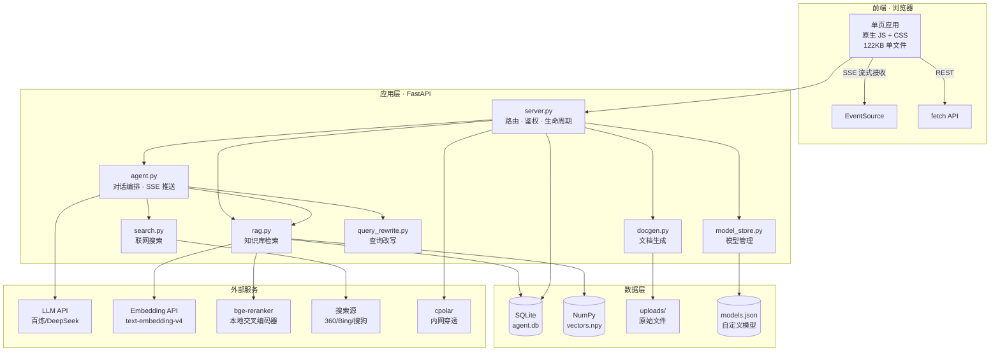
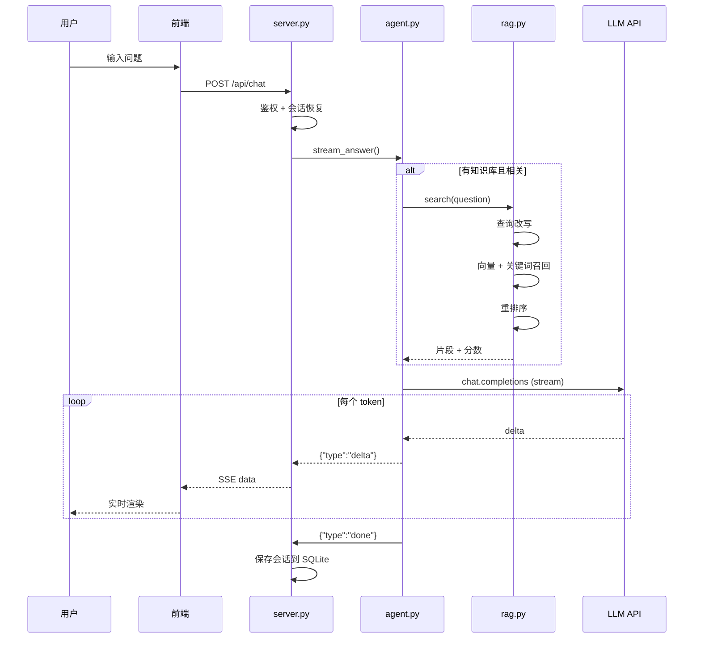

# 系统架构

> 本文档描述 AI Agent 智能体助手的整体架构、技术选型和数据流。

---

## 总体架构



---

## 分层说明

### 1. 前端层（浏览器）

| 技术 | 说明 |
|------|------|
| 原生 JavaScript | 无框架依赖，单文件 3587 行 |
| SSE (EventSource) | 接收流式响应，边生成边显示 |
| fetch API | 常规 REST 请求（上传/导出/设置） |
| CSS 变量 | 统一主题，无预处理器 |

**为什么不用框架**：
- 单文件部署，无构建步骤
- 复制一个 HTML 就能跑
- 体积 122KB，比 React 运行时还小

### 2. 应用层（FastAPI）

| 模块 | 职责 | 代码量 |
|------|------|--------|
| `server.py` | 路由、鉴权、生命周期、隧道管理 | 1364 行 |
| `agent.py` | 对话编排、消息组装、SSE 推送 | 357 行 |
| `rag.py` | 文档切分、向量化、混合检索、重排序 | 809 行 |
| `docgen.py` | Markdown → Word/PDF/HTML | 488 行 |
| `query_rewrite.py` | 规则改写 + LLM 改写 | 242 行 |
| `search.py` | 三引擎搜索、结果摘要 | 210 行 |
| `model_store.py` | 模型配置 CRUD | 253 行 |
| `rag_eval.py` | Recall/MRR/准确率评估 | 285 行 |
| `config.py` | 配置加载、客户端工厂 | 359 行 |
| `db.py` | SQLite 封装、迁移 | 497 行 |
| `utils.py` | 通用工具 | 37 行 |

### 3. 数据层

| 存储 | 存什么 | 为什么 |
|------|--------|--------|
| **SQLite** `agent.db` | 会话、消息、文档、片段、模型 | 单文件、零依赖、支持 SQL 查询 |
| **NumPy** `vectors.npy` | 向量矩阵 | 矩阵乘法比反序列化快 10 倍 |
| **文件系统** `uploads/` | 上传的原始文档 | 保留原件，便于重新解析 |
| **JSON** `models.json` | 自定义模型配置 | 迁移到 DB 前的兼容 |

### 4. 外部服务

| 服务 | 用途 | 可替换 |
|------|------|--------|
| LLM API | 对话生成 | ✅ 任意 OpenAI 兼容 |
| Embedding API | 文本向量化 | ✅ 支持本地模型 |
| bge-reranker | 检索重排序 | ✅ 可关闭 |
| 搜索引擎 | 联网查资料 | ✅ 三引擎兜底 |
| cpolar | 内网穿透 | ✅ 可选 |

---

## 核心数据流

### 对话请求流程



### RAG 检索流程

```
用户问题
   ↓
[1] 查询改写（规则 + LLM）
   ↓ 生成 2-3 个变体
[2] 混合召回
   ├─ 向量检索（余弦相似度，权重 0.7）
   └─ 关键词匹配（BM25 简化版，权重 0.3）
   ↓ Top-8
[3] 重排序（bge-reranker 交叉编码器）
   ↓ 取最高分
[4] 去重（相似度 > 0.92 合并）
   ↓
[5] 阈值过滤
   ├─ MIN_SCORE 0.10（绝对下限）
   └─ REL_SCORE 0.20（相对差距）
   ↓ Top-4
送入 LLM 上下文
```

**关键设计**：

| 环节 | 为什么这么做 |
|------|------------|
| 查询改写 | 用户问"咋崩了"，改写成"缓存雪崩 原因"召回率更高 |
| 混合检索 | 纯向量对专有名词不敏感，关键词补足 |
| 重排序 | 向量召回快但粗，交叉编码器精排 Top-K |
| 阈值过滤 | 避免无关文档硬塞进上下文，导致模型不敢答 |

---

## 技术选型对比

### 为什么用 SQLite 而不是 PostgreSQL/MySQL

| 维度 | SQLite | PG/MySQL |
|------|--------|----------|
| 部署 | 单文件，零安装 | 需服务进程 |
| 备份 | 复制文件 | mysqldump |
| 并发 | 单写多读（够用） | 高并发 |
| 适用 | 单机、个人、<10万条 | 多用户、分布式 |

**结论**：当前规模（50 条会话、134 片段）SQLite 完全够用，且启动零等待。

### 为什么用 NumPy 暴力检索而不是 FAISS/ChromaDB

```python
# 134 × 1024 矩阵，一次矩阵乘法 1 毫秒
scores = vectors @ query_vec
```

| 方案 | 134 片段耗时 | 依赖 |
|------|-------------|------|
| NumPy 矩阵乘法 | ~1 ms | 无（自带） |
| FAISS | ~0.5 ms | C++ 编译扩展 |
| ChromaDB | ~2 ms | 重量级，需服务 |

**结论**：数据量 <1 万时，NumPy 暴力检索已经足够快，且零额外依赖。

### 为什么不用 LangChain

| 对比 | 自己实现 | LangChain |
|------|---------|-----------|
| 代码量 | 809 行（rag.py） | 依赖 50+ 包 |
| 可控性 | 完全掌握 | 抽象层黑盒 |
| 调试 | 直接断点 | 需要理解框架 |
| 学习价值 | 理解原理 | 会调 API |

**结论**：作为学习项目，手写一遍比调框架收获更大。

---

## 部署架构

```
┌─────────────────────────────────────────────┐
│  本机 Windows                                │
│                                              │
│  ┌────────────────────────────────────┐    │
│  │  Python 3.11 (.venv)                │    │
│  │  ├─ uvicorn 0.0.0.0:8000           │    │
│  │  ├─ cpolar 子进程（隧道）           │    │
│  │  └─ SQLite / NumPy / 模型文件       │    │
│  └────────────────────────────────────┘    │
│                    ↓                         │
│  ┌────────────────────────────────────┐    │
│  │  cpolar 客户端                       │    │
│  │  → https://xxx.cpolar.top           │    │
│  └────────────────────────────────────┘    │
└─────────────────────────────────────────────┘
                     ↓
           ┌──────────────────┐
           │  外部访问者       │
           │  （任何网络）      │
           └──────────────────┘
```

**访问方式**：

| 地址 | 范围 | 用途 |
|------|------|------|
| `127.0.0.1:8000` | 本机 | 开发调试 |
| `192.168.x.x:8000` | 局域网 | 手机测试 |
| `xxx.cpolar.top` | 公网 | 分享给他人 |

---

## 目录结构

```
AI-Agent/
├── server.py           ← 路由 + 生命周期（入口）
├── agent.py            ← 对话编排
├── config.py           ← 配置与客户端
├── db.py               ← SQLite 数据层
├── rag.py              ← 检索核心
├── query_rewrite.py    ← 查询改写
├── search.py           ← 联网搜索
├── docgen.py           ← 文档生成
├── model_store.py      ← 模型管理
├── rag_eval.py         ← 效果评估
├── utils.py            ← 工具
├── main.py             ← 环境自检
└── static/
    └── index.html      ← 前端单文件
```

---

## 关键设计决策

| 决策 | 原因 |
|------|------|
| 单文件前端 | 无构建、易复制、体积小 |
| SSE 而非 WebSocket | 单向流足够，实现简单，自动重连 |
| SQLite 而非 PG | 单机零部署，备份=复制 |
| NumPy 而非 FAISS | 数据量小，零依赖 |
| 手写 RAG 而非 LangChain | 学习价值高，完全可控 |
| 向量存 npy 而非 DB | 矩阵运算比反序列化快 |
| 端口自动递增 | 避免重复运行冲突 |
| cpolar 独立控制台 | TUI 程序必须有真实终端 |
| 会话分组用字符串列 | 无需额外表，改名只改一个字段 |
| 头像按模型品牌配色 | 一眼区分是哪个模型答的 |
| 设置页收纳次要功能 | 侧边栏只留高频操作，减少视觉噪音 |
| DB 列存在性探测 | 老库/只读环境下自动降级，不直接报错 |

---

## 会话管理

### 数据结构

```
sessions
├── id          TEXT PRIMARY KEY
├── title       TEXT          -- 可重命名
├── created     REAL
├── updated     REAL
├── grp         TEXT          -- 分组名（空 = 未分组）
└── pinned      INTEGER       -- 0/1 置顶
```

**为什么不单独建分组表**：分组只是会话上的一个标签，用字符串列最省事。
改名分组 = 一条 UPDATE 批量改所有会话的 grp 字段。

### 交互设计

| 操作 | 方式 |
|------|------|
| 重命名 | 双击标题 / ⋯ 菜单 |
| 置顶 | ⋯ 菜单 |
| 分组 | ⋯ 菜单 → 输入组名 |
| 删除 | × 按钮 / ⋯ 菜单 |
| 折叠分组 | 点分组头 |

### 排序规则

```sql
ORDER BY pinned DESC, updated DESC
```

置顶优先，其余按最近更新。前端再按 grp 二次分组渲染。

---

## 头像系统

### 品牌映射

```
deepseek*        → 蓝紫渐变  DS
qwen3.5*         → 天蓝渐变  Q3
qwen*            → 紫色渐变  QW
*qwen3-vl*       → 橙粉渐变  VL
*qwen3-coder*    → 紫蓝渐变  CO
glm*             → 青绿渐变  GL
kimi/moonshot*   → 石墨渐变  KM
gpt/openai/o1/o3 → 墨绿渐变  AI
其他             → 灰蓝渐变  AI
```

**状态点**：右下角小圆点表示状态
- 绿色 = 回答完成
- 橙色脉冲 = 正在生成

---

## 文件上传与下载

### 上传流程

```
用户操作（粘贴 / 拖拽 / 点击选择）
      ↓
前端大小检查（超过 20MB 直接拒绝）
      ↓
POST /api/attach（multipart）
      ↓
后端按扩展名分流
   ├─ 文档 → rag.read_document() 提取文本
   └─ 图片 → base64 编码 + OCR 兜底
      ↓
返回 { text, data_url, chars, type }
      ↓
前端渲染附件卡片（缩略图 + 字数 + 警告）
```

**边界处理**：

| 情况 | 处理 |
|------|------|
| 文件超过 20MB | 前端拦截，不浪费流量 |
| 图片 + 非视觉模型 | 显示警告，建议切 qwen3-vl-plus |
| 解析失败 | toast 提示，自动移除卡片 |
| 多文件拖拽 | 顺序处理，避免并发争抢 |

### 下载流程

```
点下载 → 分析内容特征
      ↓
推荐格式（代码多→Markdown，表格多→Word，链接多→HTML）
      ↓
POST /api/export { content, title, format }
      ↓
后端生成文件 → Content-Disposition 带中文名（RFC 5987）
      ↓
前端 blob → a[download] 触发下载
      ↓
toast 反馈「Word 文档 已下载 · 37 KB」
```

---

## 历史消息语义搜索

### 为什么需要

关键词搜索（SQL LIKE）只能匹配字面。用户问「上次说的那个缓存问题」，
字面搜不到「缓存雪崩」，语义搜索可以。

### 实现

```
messages 表（已有内容）
      ↓ 批量取最近 2000 条
      ↓ 每条第 500 字做摘要
embed_texts()（复用知识库的 embedding 接口）
      ↓ 1024 维向量
msg_vectors.npy（向量矩阵）
msg_vectors 表（元信息：msg_id / session_id / role / snippet）
      ↓ 查询时
scores = vecs @ query_vec（矩阵乘法）
      ↓ 阈值 0.25 过滤
返回 top-k（带会话标题）
```

**设计取舍**：

| 决策 | 原因 |
|------|------|
| 只索引前 500 字 | 长回答全量索引会让向量表膨胀 10 倍 |
| 向量存 npy 而非 BLOB | 矩阵乘法比逐条反序列化快 |
| 阈值 0.25 | 低于此值的召回基本是噪音 |
| 需要手动触发重建 | 每次对话都做 embedding 会拖慢响应 |

### 启用条件

**需要数据库可写**（创建 msg_vectors 表）。

只读环境下：
- `GET /api/semantic-search` 返回 `available: false` 和提示信息
- 前端显示「未构建」并提供重建按钮
- 不影响其他功能

---

---

## 性能特征

| 操作 | 耗时 | 说明 |
|------|------|------|
| 启动服务 | ~3 秒 | 无隧道模式 |
| 启动 + 隧道 | ~25 秒 | 等 cpolar 分配地址 |
| 纯对话（无检索） | 2-4 秒 | qwen-flash |
| 带知识库检索 | 4-8 秒 | 含改写+召回+重排 |
| 向量检索（134 条） | ~1 毫秒 | 矩阵乘法 |
| 重排序（8 条） | ~100 毫秒 | 交叉编码器 |
| 文档导出 Word | ~500 毫秒 | python-docx |
| 文档导出 PDF | ~800 毫秒 | reportlab |

---

## 扩展性

### 容易扩展的

- **加模型**：网页设置或改 `MODEL_CATALOG`
- **加导出格式**：`docgen.py` 加一个 `to_xxx()` 函数
- **加搜索引擎**：`search.py` 加一个引擎实现
- **加评估指标**：`rag_eval.py` 加计算函数

### 需要改造的

| 需求 | 改造点 |
|------|--------|
| 多用户并发 | SQLite → PostgreSQL，加用户表 |
| 万级文档 | NumPy → FAISS，加增量索引 |
| 分布式部署 | 会话状态外置到 Redis |
| 权限控制 | 加 RBAC 表 + JWT |
